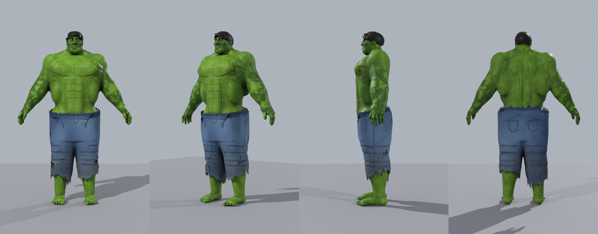

# Hulk – GTA V ped model (Blender + Sollumz)

A bulky green Hulk in torn jeans, built as a proper **GTA V ped**: the stock 549‑bone ped skeleton, skin weights,
the standard ped component split, LODs, ped shaders and DXT textures. It is generated entirely by code
(`build_hulk_ped.py`), so every proportion can be tweaked and rebuilt.



## What you get (`out/`)

| Path | What |
|---|---|
| `hulk_ped.blend` | Sollumz scene with textures packed in (Blender 5.0 file; Sollumz add‑on must be enabled). DDS textures are DXT1/DXT5 with mips; normal maps are DirectX style (green inverted) like the game expects. Six *Drawable Dictionaries* – one per ped component – sharing one armature with the full GTA V ped skeleton. |
| `hulk_ped_gta5_xml.zip` → `*.ydd.xml` | CodeWalker‑XML drawables: `head_000_r`, `hair_000_u`, `uppr_000_r`, `hand_000_r`, `lowr_000_r`, `feet_000_r`. Four LODs each (high / med / low / very low). Normal + spec maps embedded (`<name>/*.dds`). |
| `*_diff_000_a_uni.ytd.xml` (same zip) | One texture dictionary per diffuse map (+ the DDS in a folder next to it). |
| `preview/` | Renders and `hulk_ped_rest.glb` / `hulk_ped_pose.glb` (static, for viewing in any glTF viewer). |

### Component layout (like a streamed ped)

| File | Content | Shader | Tris (high) |
|---|---|---|---|
| `head_000_r` | head + neck, eyeballs (2nd material) | `ped.sps` / `ped_default.sps` | ~5–6k |
| `hair_000_u` | short black hair | `ped_default.sps` | ~1.6k |
| `uppr_000_r` | torso + arms to the wrists | `ped.sps` | ~8.5k |
| `hand_000_r` | both hands, separate fingers | `ped.sps` | ~1.7k |
| `lowr_000_r` | torn baggy jeans (open waist, ragged hems) | `ped_default.sps` | ~3.8k |
| `feet_000_r` | shins + bare feet (shows below the hem) | `ped.sps` | ~2.8k |

Total ≈ 24k triangles at the highest LOD. Origin = pelvis, character faces −Y, feet at z = −1.0 (the game's
ped convention).

## Using it

**Blender + Sollumz (recommended).** Install [Sollumz](https://github.com/Sollumz/Sollumz) (Blender 4.2+), open
`out/hulk_ped.blend`, select the dictionaries and use *Sollumz → Export*. On Windows with PyMateria installed this
writes binary `.ydd`/`.ytd` directly. Weights are stored by **bone name**, so if your target ped uses a different
skeleton, replace the armature and re‑export – indices are recomputed on export.

**CodeWalker.** Import the `.ydd.xml` / `.ytd.xml` files (RPF Explorer → *Import XML*) to turn them into binary
assets. Drop them into the component folder of the ped you want to replace (or an add‑on ped) and make sure the
ped's `.yft` uses the same stock skeleton.

> Not tested inside GTA V itself – there is no game here. The assets were validated by exporting with Sollumz
> and reading the result back (finite vertex data, bone indices < 549, normalised weights, all four LODs, tangents,
> embedded textures). Ped mod packaging (`.yft`, `.ymt`, `peds.meta`) is not included.

## Rebuild

```sh
git clone https://github.com/Sollumz/Sollumz          # needs Sollumz (GPL‑3.0)
pip install bpy numpy scipy scikit-image pillow xatlas szio
python build_hulk_ped.py --sollumz ./Sollumz            # ~10 min;  --quick for a fast low‑res pass
```

Pipeline: signed‑distance sculpt of every muscle placed relative to the ped skeleton's joints (`lib/anatomy.py`) →
marching cubes → Blender decimation → split into ped components → structured UV unwrap (island labelling + LSCM +
xatlas packing) → texture bake straight from the sculpt (AO, hi‑res tangent‑space normals, procedural skin / denim)
→ skin weights against the ped bones (`lib/skinning.py`) → Sollumz scene + XML export.

## Credits / licences

`data/ped_skeleton.json` is the stock GTA V ped skeleton as shipped in Sollumz' `tools/BoneProperties.xml`
(GPL‑3.0). Sollumz and `szio` are used for the GTA asset I/O.
